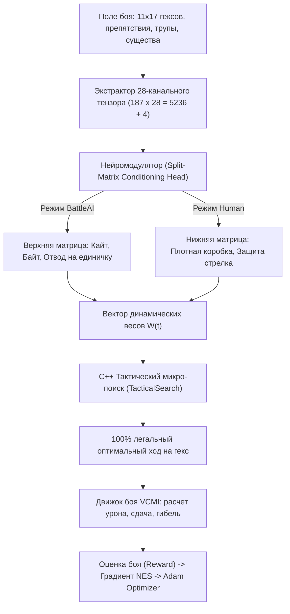

# 🗺️ Генеральный план реализации: Нейро-символический Combat AI для HoMM3 (VCMI) + C++20 Training Core + Web Dashboard

---

## 📌 Оглавление
1. [Архитектурная концепция и математический фундамент](#1-архитектурная-концепция)
2. [Структура 28-канального тензора поля боя (Spatial Hex Tensor)](#2-структура-тензора-поля-боя)
3. [Модуль обучения: Natural Evolution Strategies (NES) + Adam Optimizer в C++](#3-модуль-обучения-nes--adam)
4. [Двухуровневая архитектура принятия решений (Director + Micro Search)](#4-двухуровневая-архитектура)
5. [C++20 Боевой движок симуляции (VCMI Combat Physics Core)](#5-боевой-движок-симуляции)
6. [Протокол взаимодействия (IPC / JSON Streaming Bridge)](#6-протокол-взаимодействия)
7. [Веб-интерфейс: Интерактивная карта, Шкалы весов, C++ Консоль](#7-веб-интерфейс-и-визуализация)
8. [Пошаговый план реализации (Атомарные шаги с проверкой совместимости)](#8-пошаговый-план-реализации)
9. [Таблица рисков, краевых случаев и верификации](#9-таблица-рисков-и-верификации)

---

## 1. Архитектурная концепция

### Проблема классического End-to-End RL
В проектах вроде `vcmi-gym` нейросеть принимает тысячи чисел и пытается выдать дискретный индекс действия из 2310 вариантов ($165 \text{ гексов} \times 14 \text{ типов ходов}$).
- **Следствие:** 95% действий в любой момент нелегальны (попытка шагнуть в скалу, ударить пустоту, выстрелить через блок).
- **Результат:** Сеть тратит миллионы итераций просто на то, чтобы научиться «не биться о стены».

### Наше решение: Двухуровневый Нейро-символический Гибрид


---

## 2. Структура тензора поля боя (28 каналов на гекс)

Сетка поля боя: **11 рядов $\times$ 17 колонок = 187 гексов** (полный стандарт VCMI с краевыми гексами и воротами).

| № | Название канала | Диапазон | Физический и тактический смысл |
|---|---|---|---|
| 0 | `CH_OBSTACLE` | $[0.0, 1.0]$ | $1.0$ — непроходимое препятствие (камень, бревно, стена), $0.0$ — чисто |
| 1 | `CH_HAZARD` | $[0.0, 1.0]$ | $0.5$ — ров, $1.0$ — огненная стена или мина |
| 2 | `CH_CORPSE_HP` | $[0.0, 1.0]$ | Нормализованное здоровье трупа на гексе (цель для поднятия мертвецов) |
| 3 | `CH_GATE_WALL` | $[0.0, 1.0]$ | Ворота замка или зубец стены ($1.0$ закрыто, $0.0$ разрушено/открыто) |
| 4 | `CH_UNIT_SIDE` | $\{-1, 0, 1\}$ | $+1.0$ — союзник, $-1.0$ — враг, $0.0$ — гекс свободен |
| 5 | `CH_TWO_HEX` | $\{0, 1\}$ | $1.0$ — существо занимает 2 гекса (Драконы, Кони, Гидры) |
| 6 | `CH_IS_ACTIVE` | $\{0, 1\}$ | $1.0$ на гексе существа, чей ход рассчитывается прямо сейчас |
| 7 | `CH_QUEUE_PRIORITY`| $[-1.0, 1.0]$ | $+1.0$ — следующим ходит союзное ядро (стрелок), $-1.0$ — враг |
| 8 | `CH_COUNT_NORM` | $[0.0, 1.0]$ | Численность отряда: $\min(1.0, \text{count} / 50.0)$ |
| 9 | `CH_TOTAL_HP_NORM`| $[0.0, 1.0]$ | Суммарное текущее здоровье отряда: $\text{totalHp} / (\text{count} \times \text{hpPerUnit})$ |
| 10| `CH_TOP_UNIT_HP` | $[0.0, 1.0]$ | Здоровье верхнего юнита: показывает порог ваншота первой модели |
| 11| `CH_ATTACK` | $[0.0, 1.0]$ | Атака юнита с учетом первичных навыков героя: $\text{atk} / 40.0$ |
| 12| `CH_DEFENSE` | $[0.0, 1.0]$ | Защита юнита с учетом героя и заклинаний: $\text{def} / 40.0$ |
| 13| `CH_SPEED` | $[0.0, 1.0]$ | Скорость юнита (радиус угрозы на следующий раунд): $\text{spd} / 20.0$ |
| 14| `CH_DMG_MIN` | $[0.0, 1.0]$ | Минимальный базовый урон: $\text{minDmg} / 50.0$ |
| 15| `CH_DMG_MAX` | $[0.0, 1.0]$ | Максимальный урон: разница с `min` задает разброс урона |
| 16| `CH_IS_FLYING` | $\{0, 1\}$ | $1.0$ — летун (игнорирует препятствия и рвы при движении) |
| 17| `CH_IS_SHOOTER` | $\{0, 1\}$ | $1.0$ — стрелок (есть стрелы и нет штрафа прямого блока) |
| 18| `CH_SHOTS_LEFT` | $[0.0, 1.0]$ | Оставшийся запас боеприпасов: $\text{shots} / 24.0$ |
| 19| `CH_CAN_RETALIATE`| $\{0, 1\}$ | $1.0$ — есть ответный удар, $0.0$ — ответка на этот раунд уже снята |
| 20| `CH_INF_RETALIATE`| $\{0, 1\}$ | $1.0$ — бесконечная ответка (Королевские грифоны) |
| 21| `CH_CAN_CAST` | $\{0, 1\}$ | $1.0$ — кастер (Архангелы, Джинны, Чародеи, Питлорды) |
| 22| `CH_NO_MELEE_PEN`| $\{0, 1\}$ | $1.0$ — стрелок без штрафа в рукопашной (Лучники, Монахи) |
| 23| `CH_NO_RETAL_ATK`| $\{0, 1\}$ | $1.0$ — атака без ответа (Церберы, Вампиры-лорды, Гидры) |
| 24| `CH_MORALE` | $[-1.0, 1.0]$ | Мораль от $-3$ до $+3$: шанс повторного хода или ступора |
| 25| `CH_LUCK` | $[0.0, 1.0]$ | Удача от $0$ до $+3$: шанс удвоенного урона |
| 26| `CH_IS_DISABLED` | $\{0, 1\}$ | $1.0$ — юнит выключен из боя (Слепота, Паралич, Окаменение, Берсерк) |
| 27| `CH_SPEED_BUFF` | $\{-1, 0, 1\}$ | Статус скорости: $-1.0$ (Slow), $+1.0$ (Haste), $0.0$ (норма) |

**Глобальный контекст (4 канала):**
- $G_0$: `GL_IS_BATTLE_AI` — $1.0$ (против жадного бота VCMI), $0.0$ (против человека).
- $G_1$: `GL_ARMY_RATIO` — соотношение суммарной боевой силы $\text{Value}_{\text{ally}} / \text{Value}_{\text{enemy}}$.
- $G_2$: `GL_ROUND_NUM` — текущий раунд боя ($\text{round} / 30.0$).
- $G_3$: `GL_CORE_THREAT` — минимальная дистанция от вражеских милишников до союзного стрелка.

**Размерность плоского вектора на вход сети:**
$$187 \times 28 + 4 = 5240 \text{ чисел (всего 20.5 Кб в памяти)}.$$

---

## 3. Модуль обучения: NES + Adam Optimizer

### Почему Natural Evolution Strategies (NES)?
Среда HoMM3 недифференцируема: выстрел или шаг на гекс — это дискретный оператор. 
Алгоритм OpenAI NES позволяет находить градиент оптимизации без ручной дифференциации игрового симулятора:

1. **Параметры сети:** Вектор весов $\theta \in \mathbb{R}^P$.
2. **Семплирование популяции:** В каждом поколении генерируется $N$ возмущений:
   $$\theta_i = \theta + \sigma \epsilon_i, \quad \epsilon_i \sim \mathcal{N}(0, I), \quad i \in [1, N].$$
3. **Параллельная симуляция:** Каждый агент $\theta_i$ играет бой на Погосте.
4. **Функция награды (Reward):**
   $$R_i = \Delta\text{HP}_{\text{enemy\_dead}} - 100 \times \Delta\text{HP}_{\text{archers\_lost}} - 2 \times \Delta\text{HP}_{\text{pikemen\_lost}} + 500 \cdot \mathbb{I}(\text{Win\_Zero\_Losses}).$$
5. **Эмпирический градиент:**
   $$\nabla_\theta J \approx \frac{1}{\sigma N} \sum_{i=1}^N \epsilon_i R_i.$$
6. **Обновление через Adam Optimizer в C++:**
   $$m_t = \beta_1 m_{t-1} + (1 - \beta_1) \nabla_\theta J,$$
   $$v_t = \beta_2 v_{t-1} + (1 - \beta_2) (\nabla_\theta J \odot \nabla_\theta J),$$
   $$\hat{m}_t = \frac{m_t}{1 - \beta_1^t}, \quad \hat{v}_t = \frac{v_t}{1 - \beta_2^t},$$
   $$\theta_{t+1} = \theta_t + \eta \frac{\hat{m}_t}{\sqrt{\hat{v}_t} + \epsilon}.$$

---

## 4. Двухуровневая архитектура принятия решений

### Уровень 1: Нейромодулятор (Director)
- **Вход:** Тензор $[5240]$.
- **Скрытый слой:** $5240 \to 64$ (SiLU / ReLU активация).
- **Сплит-матрица (Dual-Head):** $[16 \times 64]$.
  - Верхняя половина (Строки $0 \dots 7$): Веса для игры против **BattleAI**.
  - Нижняя половина (Строки $8 \dots 15$): Веса для игры против **Human**.
- **Выход:** Вектор динамических весов $W(t) = [w_{\text{retal}}, w_{\text{block}}, w_{\text{corpse}}, w_{\text{screen}}, w_{\text{tempo}}, w_{\text{dmg}}, w_{\text{pen}}, w_{\text{kite}}, w_{\text{bait}}]$.

### Уровень 2: Тактический микро-поиск (TacticalSearch)
Для активного юнита генерируются **только физически легальные ходы**:
- Выстрел во врага (с проверкой линии видимости и блокировки в упор).
- Перемещение на любой проходимый гекс в пределах скорости юнита.
- Удар в рукопашную с любого доступного направления (сверху, снизу, сбоку).
- Выжидание (Wait) или Защита (Defend).

Для каждого хода вычисляется вектор признаков $F = [f_1, \dots, f_K]$:
$$\text{Utility}(a) = \sum_{k=1}^K W_k(t) \cdot f_k(a).$$
Выбирается ход с максимальной полезностью: $a^* = \arg\max_a \text{Utility}(a)$.

---

## 5. C++20 Боевой движок симуляции (VCMI Combat Physics Core)

### Полная реализация механик боя
1. **Гексагональная геометрия (Axial Coordinates):**
   - Расстояние между гексами: $\text{dist}(h_1, h_2) = \frac{|\Delta r| + |\Delta c| + |\Delta r - \Delta c|}{2}$.
   - Проходимость с учетом препятствий (поиск пути BFS / Dijkstra).
2. **Очередь ходов (Turn Queue):**
   - Сортировка по скорости $\text{Speed}$.
   - Поддержка фазы ожидания (Wait): юнит ходит в конце раунда.
3. **Формула урона HoMM3 / VCMI:**
   $$\text{Damage} = \text{Count} \times \text{Random}(\text{MinDmg}, \text{MaxDmg}) \times \left(1 + 0.05 \cdot \max(0, \text{Atk} - \text{Def})\right) \times \left(1 - 0.025 \cdot \max(0, \text{Def} - \text{Atk})\right).$$
4. **Правила стрельбы:**
   - Прямой выстрел ($\le 10$ гексов): $100\%$ урона.
   - Дальний выстрел ($> 10$ гексов): $50\%$ урона (штраф за расстояние).
   - Враг в соседнем гексе: блокировка стрельбы (только рукопашная со штрафом $50\%$, если нет свойства `no_melee_penalty`).
5. **Механика ответного удара:**
   - Ровно 1 сдача на раунд (кроме существ с бесконечной ответкой).
   - Если цель погибает от удара — ответка не наносится.
6. **Жадный алгоритм BattleAI (для Зомби):**
   - Находит ближайшего врага по формуле ценности и расстояния.
   - Идет кратчайшим путем к нему. Если дошел — бьет.

---

## 6. Протокол взаимодействия (IPC / JSON Streaming Bridge)

C++ процесс общается с Node.js сервером через стандартный ввод/вывод (stdin/stdout) пакетами JSON в одну строку (NDJSON):

```json
{"event":"turn_start","round":1,"active_stack":2,"unit":"Pikeman","hex":35}
{"event":"weights_generated","weights":{"strip_retaliation":3720,"screen_core":300,"kite_distance":31965,"bait_diversion":38359}}
{"event":"action_executed","action":"MOVE","from":35,"to":68,"reason":"Baiting slow melee away from shooter"}
{"event":"damage_dealt","attacker":1,"target":10,"damage":42,"killed":2,"retaliation":0}
{"event":"training_step","generation":45,"reward":1980,"win_rate":0.95,"zero_loss_rate":0.88}
```

---

## 7. Веб-интерфейс и визуализация

### 1. Карта поля боя (Hex Grid Canvas)
- Отрисовка 187 гексов с изометрической разметкой и номерами.
- Препятствия (камни), трупы, лучники (синие), пикинеры (синие), зомби (красные).
- Анимация перемещения по гексам, пунктирная линия траектории стрелы.
- Подсветка дальности хода активного юнита.

### 2. Панель управления и режимы
- Кнопка **[Шаг хода (Step)]** — пошаговый разбор каждого действия.
- Кнопка **[Авто-бой (Play/Pause)]** — автоматический бой с регулировкой скорости ($1\times, 2\times, 5\times$).
- Переключатель режима: **[Против BattleAI (Бот)]** / **[Против Человека]**.
- Кнопка **[Запустить обучение (Train 200)]** — запуск оптимизатора Adam.

### 3. Окно нейросети и динамических весов
- Индикаторы весов в реальном времени с цветовой подсветкой:
  - `w_bait_diversion` (Зеленый / Неон)
  - `w_kite_distance` (Голубой)
  - `w_strip_retaliation` (Желтый)
  - `w_screen_core` (Пурпурный)
- График обучения в реальном времени (Chart.js / Canvas):
  - Кривая средней награды (Reward).
  - Процент побед без потерь (Zero Loss %).

### 4. Терминал движка C++ VCMI
- Стилизованная консоль с подсветкой синтаксиса:
  - Логи расчета урона.
  - Состояние тензора поля боя.
  - Причины выбора конкретного хода.

---

## 8. Пошаговый план реализации (50 атомарных шагов)

Каждый шаг полностью изолирован, тестируется отдельно и перепроверяется на совместимость.

### ЭТАП I: Ядро физики боя на C++20 (Combat Physics)
- [x] **Шаг 1.1:** Создать заголовочный файл `HexGrid.h` — структуры `BattleHex`, расчет расстояний, 6 направлений соседей на сетке $11 \times 17$. [ВЫПОЛНЕНО]
- [x] **Шаг 1.2:** Реализовать `Pathfinder.h/.cpp` — волновой алгоритм BFS / Dijkstra для поиска доступных клеток с учетом статических препятствий. [ВЫПОЛНЕНО]
- [x] **Шаг 1.3:** Написать юнит-тест `test_hex_grid.cpp` / `test_pathfinder.cpp` — проверка корректности расстояний и обхода препятствий. [ВЫПОЛНЕНО]
- [x] **Шаг 1.4:** Создать структуры данных боевых отрядов `CombatStack.h` — все 28 характеристик (HP, урон, стрелы, ответка, скорость, размер). [ВЫПОЛНЕНО]
- [x] **Шаг 1.5:** Реализовать калькулятор урона `DamageCalculator.h/.cpp` — полная формула HoMM3 с разбросом min/max урона, атакой/защитой героя. [ВЫПОЛНЕНО]
- [x] **Шаг 1.6:** Реализовать механику выстрелов — проверка соседних врагов (блокировка), дальности (> 10 гексов — штраф 50%), учет запаса стрел. [ВЫПОЛНЕНО]
- [x] **Шаг 1.7:** Реализовать механику ближнего боя и ответного удара — снятие флага `hasRetaliation`, проверка гибели цели до ответки. [ВЫПОЛНЕНО]
- [x] **Шаг 1.8:** Реализовать менеджер очереди ходов `TurnQueue.h/.cpp` — сортировка по скорости, фаза Wait, переход раунда. [ВЫПОЛНЕНО]
- [x] **Шаг 1.9:** Реализовать обработку гибели отряда — создание трупа на гексе, удаление из активных отрядов. [ВЫПОЛНЕНО]
- [x] **Шаг 1.10:** Написать консольный тест `test_combat_physics.cpp` — просимулировать дуэль 1 на 1 и проверить точность урона по правилам VCMI. [ВЫПОЛНЕНО]

### ЭТАП II: Алгоритмический бот противника (VCMI BattleAI Replica)
- [x] **Шаг 2.1:** Реализовать `EnemyBattleAI.h/.cpp` — жадный алгоритм выбора цели для Зомби. [ВЫПОЛНЕНО]
- [x] **Шаг 2.2:** Реализовать выбор ближайшей доступной цели (Target Selector) — милишник выбирает цель с наименьшим путем. [ВЫПОЛНЕНО]
- [x] **Шаг 2.3:** Реализовать движение к цели — если цель недосягаема за 1 ход, бот идет на ближайшую клетку по направлению к ней. [ВЫПОЛНЕНО]
- [x] **Шаг 2.4:** Реализовать атаку цели — выбор гекса атаки при достижении. [ВЫПОЛНЕНО]
- [x] **Шаг 2.5:** Написать юнит-тест `test_enemy_ai.cpp` — проверить, что Зомби всегда бегут на ближайшего пикинера, если он ближе стрелка. [ВЫПОЛНЕНО]

### ЭТАП III: 28-канальный тензор и экстрактор (Tensor Pipeline)
- [x] **Шаг 3.1:** Обновить `BattlefieldTensor.h` — поддержка 28 каналов на гекс ($187 \times 28 = 5236$) + 4 глобальных канала. [ВЫПОЛНЕНО]
- [x] **Шаг 3.2:** Реализовать методы быстрой нормализации и запекания признаков (Data-Oriented SIMD-friendly layout). [ВЫПОЛНЕНО]
- [x] **Шаг 3.3:** Реализовать метод `extractFromState()` — автоматическое заполнение тензора из текущего состояния боя. [ВЫПОЛНЕНО]
- [x] **Шаг 3.4:** Реализовать кодирование очереди инициативы (канал `CH_QUEUE_PRIORITY`) с разметкой союзного ядра и врагов. [ВЫПОЛНЕНО]
- [x] **Шаг 3.5:** Написать юнит-тест `test_tensor_extractor.cpp` — проверить корректность размерности $5240$ и отсутствие `NaN`. [ВЫПОЛНЕНО]

### ЭТАП IV: Нейромодулятор весов и сплит-матрица (Neural Modulator)
- [x] **Шаг 4.1:** Создать класс `NeuralWeightModulator.h/.cpp` с плоской памятью под веса $W_1 [64 \times 5240]$ и $W_{2\_dual} [16 \times 64]$. [ВЫПОЛНЕНО]
- [x] **Шаг 4.2:** Реализовать быстрый прямой проход `forward()` с векторизацией цикла перемножения матриц. [ВЫПОЛНЕНО]
- [x] **Шаг 4.3:** Реализовать кондиционирование: выбор верхней половины ($0 \dots 7$) для BattleAI и нижней половины ($8 \dots 15$) для Человека. [ВЫПОЛНЕНО]
- [x] **Шаг 4.4:** Реализовать выгрузку и загрузку весов в бинарный/JSON формат (`saveWeights`, `loadWeights`). [ВЫПОЛНЕНО]
- [x] **Шаг 4.5:** Написать юнит-тест `test_modulator_forward.cpp` — замерить скорость инференса (целевое время: $< 20$ микросекунд). [ВЫПОЛНЕНО]

### ЭТАП V: Тактический микро-поиск (Micro-Action Search)
- [x] **Шаг 5.1:** Обновить `TacticalFeatures.h` под полный набор признаков (кайт, байт, прикрытие, срыв ответки, урон, штрафы). [ВЫПОЛНЕНО]
- [x] **Шаг 5.2:** Реализовать генератор кандидатов ходов: сбор всех легальных гексов движения, выстрелов и атак. [ВЫПОЛНЕНО]
- [x] **Шаг 5.3:** Реализовать вычисление признака `kitesEnemy` — разрыв дистанции со стрелком. [ВЫПОЛНЕНО]
- [x] **Шаг 5.4:** Реализовать вычисление признака `baitsEnemy` — увод зомби в сторону от ядра. [ВЫПОЛНЕНО]
- [x] **Шаг 5.5:** Реализовать вычисление признака `screensAllyCore` — блокировка прохода к лучнику. [ВЫПОЛНЕНО]
- [x] **Шаг 5.6:** Реализовать вычисление полезности хода $\text{Utility} = \sum W_k \cdot f_k$. [ВЫПОЛНЕНО]
- [x] **Шаг 5.7:** Написать юнит-тест `test_tactical_search.cpp` — проверить выбор оптимального хода для заданных весов. [ВЫПОЛНЕНО]

### ЭТАП VI: Настоящий оптимизатор Adam и цикл обучения NES
- [x] **Шаг 6.1:** Создать класс `AdamOptimizer.h` — реализация скользящих средних первого и второго моментов ($m_t, v_t$). [ВЫПОЛНЕНО]
- [x] **Шаг 6.2:** Реализовать класс `NESTrainer.h/.cpp` — генерация возмущений $\theta + \sigma \epsilon_i$. [ВЫПОЛНЕНО]
- [x] **Шаг 6.3:** Реализовать функцию симуляции полного матча от начального состояния до победы/поражения. [ВЫПОЛНЕНО]
- [x] **Шаг 6.4:** Реализовать функцию вычисления награды (Reward Function) с жестким штрафом за потери стрелков. [ВЫПОЛНЕНО]
- [x] **Шаг 6.5:** Реализовать сбор эмпирического градиента и шаг `AdamOptimizer::step()`. [ВЫПОЛНЕНО]
- [x] **Шаг 6.6:** Написать консольную тренировку `train_headless.cpp` на 200 эпох — зафиксировать рост награды от случайных весов до победы с 0 потерь. [ВЫПОЛНЕНО]

### ЭТАП VII: C++ JSON Streaming Engine (IPC Backend)
- [x] **Шаг 7.1:** Создать `EngineServer.cpp` — запуск движка в режиме сервера с чтением команд из `stdin` и выводом JSON в `stdout`. [ВЫПОЛНЕНО]
- [x] **Шаг 7.2:** Команда `INIT_BATTLE` — инициализация сценария Погоста (35 Зомби vs 15 Лучников + 2 пикинера). [ВЫПОЛНЕНО]
- [x] **Шаг 7.3:** Команда `STEP_TURN` — выполнение одного хода текущего юнита и выдача полного состояния доски и весов. [ВЫПОЛНЕНО]
- [x] **Шаг 7.4:** Команда `RUN_TRAIN <epochs>` — запуск обучения в фоне со стримингом прогресса каждые 5 эпох. [ВЫПОЛНЕНО]
- [x] **Шаг 7.5:** Проверить работу через консоль: ручной ввод команд и валидация JSON-ответов. [ВЫПОЛНЕНО]

### ЭТАП VIII: Node.js Bridge Server
- [x] **Шаг 8.1:** Создать `server.js` на встроенных модулях Node.js (`http`, `child_process`, `fs`). [ВЫПОЛНЕНО]
- [x] **Шаг 8.2:** Реализовать статический веб-сервер для отдачи файлов фронтенда (`index.html`, `style.css`, `app.js`). [ВЫПОЛНЕНО]
- [x] **Шаг 8.3:** Реализовать Server-Sent Events (SSE) эндпоинт `/api/stream` для передачи логов C++ движка в браузер. [ВЫПОЛНЕНО]
- [x] **Шаг 8.4:** Реализовать REST эндпоинты `/api/step`, `/api/auto`, `/api/reset`, `/api/train`. [ВЫПОЛНЕНО]
- [x] **Шаг 8.5:** Проверить связь: запустить Node.js сервер и убедиться, что команды доходят до C++ процесса и возвращают JSON. [ВЫПОЛНЕНО]

### ЭТАП IX: Интерактивный Веб-Интерфейс (Frontend)
- [x] **Шаг 9.1:** Создать `index.html` — разметка из трех панелей: Поле боя (слева), Консоль и Дашборд весов (справа), Панель управления (снизу). [ВЫПОЛНЕНО]
- [x] **Шаг 9.2:** Создать `style.css` — премиальный темный интерфейс (Dark Fantasy / Glassmorphism), шрифт Inter / Outfit, светящиеся неоновые акценты. [ВЫПОЛНЕНО]
- [x] **Шаг 9.3:** Реализовать рендеринг гексагональной сетки на HTML5 Canvas в `app.js` — отрисовка 187 гексов, препятствий и трупов. [ВЫПОЛНЕНО]
- [x] **Шаг 9.4:** Реализовать отрисовку отрядов — токены лучников, пикинеров и зомби, плашки количества и полоски здоровья. [ВЫПОЛНЕНО]
- [x] **Шаг 9.5:** Реализовать динамические шкалы весов — анимированные полосы прогресса для `w_bait_diversion`, `w_kite_distance`, `w_strip_retaliation`. [ВЫПОЛНЕНО]
- [x] **Шаг 9.6:** Реализовать живой график обучения — отрисовка кривой Reward и Win Rate по эпохам. [ВЫПОЛНЕНО]
- [x] **Шаг 9.7:** Реализовать терминал C++ логов — автоматическая прокрутка, цветовая подсветка урона и тактических решений. [ВЫПОЛНЕНО]
- [x] **Шаг 9.8:** Привязать кнопки управления: Step (одиночный шаг), Play (авто-бой с таймером), Reset, Train. [ВЫПОЛНЕНО]
- [x] **Шаг 9.9:** Добавить анимации: полет стрелы от лучника к зомби, всплывающие цифры урона (`-42 HP`), красная вспышка при ударе. [ВЫПОЛНЕНО]
- [x] **Шаг 9.10:** Финальное сквозное тестирование: открыть браузер, запустить обучение с нуля, наблюдать адаптацию весов и победу на Погосте с 0 потерь! [ВЫПОЛНЕНО]

---

## 9. Таблица рисков, краевых случаев и верификации

| Потенциальный баг / риск | Причина возникновения | Архитектурное решение в плане |
|---|---|---|
| **Краш из-за нехватки DLL MinGW** | Динамическая линковка `libgcc` / `libstdc++` | Флаги компилятора `-static -static-libgcc -static-libstdc++` |
| **Ошибки гексагональных координат** | Разница между четными и нечетными рядами | Использование единой осевой системы координат (Axial coordinates) |
| **Зависание цикла обучения** | Бесконечный кайт без нанесения урона | Лимит раундов (максимум 40 раундов на бой; при превышении — штраф за затягивание) |
| **Деление на ноль в формуле Adam** | Нулевая дисперсия градиентов $v_t = 0$ | Параметр сглаживания $\epsilon = 10^{-8}$ в знаменателе |
| **Рассинхрон Node.js и C++** | Блокирующий ввод/вывод в конвейере pipe | Асинхронный построчный буфер (Line-buffered NDJSON) |
| **Падение производительности в браузере** | Перерисовка всего холста каждый тик | Отрисовка по запросу `requestAnimationFrame` только при изменении состояния |
